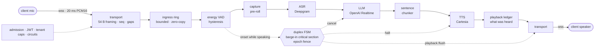
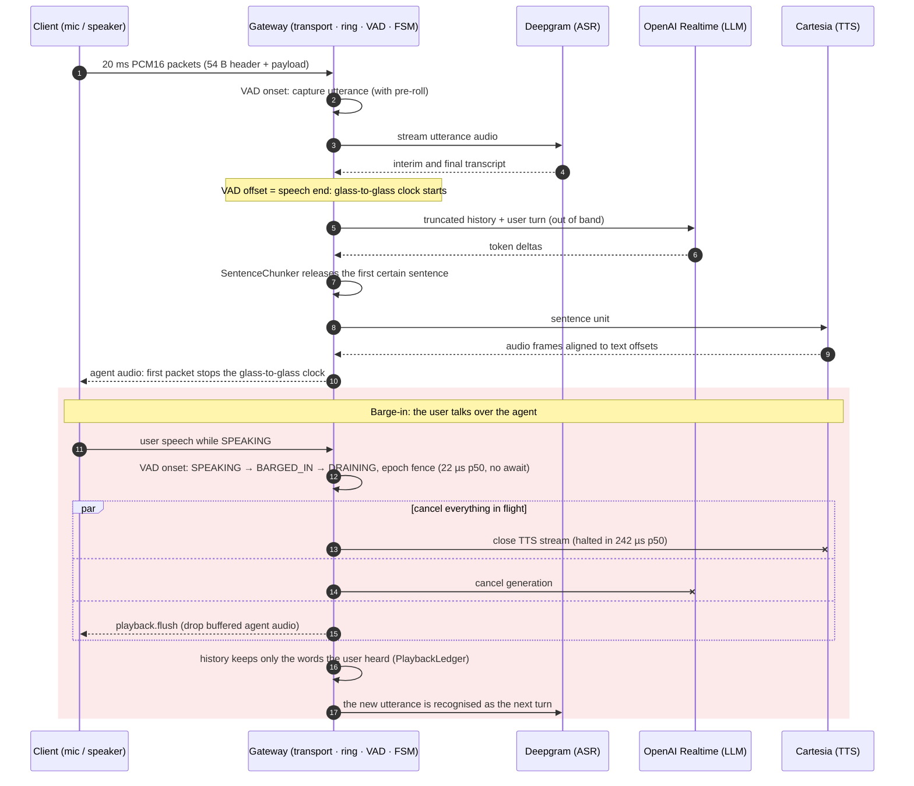
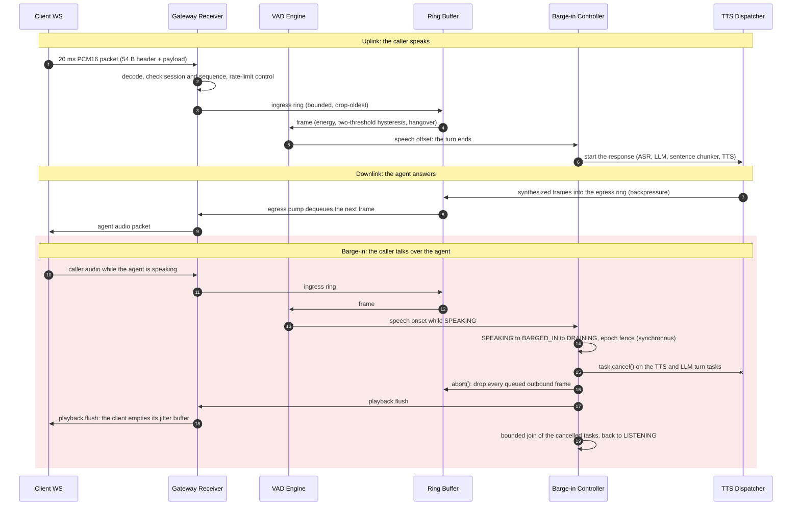

# voice-ai-realtime-gateway

[](../../actions/workflows/ci.yml)
[](pyproject.toml)
[](scripts/coverage-gate.sh)
[](pyproject.toml)
[](docs/PRODUCTION.md#6-mutation-testing)
[](pyproject.toml)
[](deploy/Dockerfile)
[](pyproject.toml)
[](../../commits/main)

A full-duplex voice agent gateway for Python 3.12+ and asyncio: audio in, speech
recognition, LLM, speech synthesis, audio out, over one WebSocket per call. It handles
barge-in in microseconds, keeps memory bounded per call, and drains gracefully across
rollouts. The package has **zero runtime dependencies**. The ASGI server is a
deployment choice, pinned only in the container image.

## Architecture



Around every call: admission before the upgrade, a per-call watchdog, the zombie reaper,
the two-phase drain and Prometheus metrics. Each process runs one event loop.


| Layer | Package | Responsibility |
|---|---|---|
| Domain | `domain/` | 8-state session FSM with a synchronous barge-in critical section, Lamport ordering, task supervision |
| Core | `core/` | bounded zero-copy `AudioRingBuffer` (backpressure or drop-oldest, epoch fencing), token buckets |
| Transport | `transport/` | binary audio packets plus typed JSON control on one WebSocket; RFC 6455 close codes; heartbeat; `MemoryWebSocket` |
| VAD | `vad/` | deterministic energy VAD with two-threshold hysteresis and hangover |
| Inference | `inference/` | `VoiceAgentPipeline`: ASR → LLM → sentence chunker → TTS behind async-generator ports; truthful history under barge-in |
| Adapters | `adapters/` | Deepgram, OpenAI Realtime and Cartesia behind those ports, sharing one retry and reconnect state machine |
| Production | `production/` | JWT admission, tenant policy, per-provider circuit breakers, zombie reaper, Prometheus metrics, status app |
| Deploy | `deploy/` | ASGI front end, two-phase graceful drain, preStop hook, settings, demo app |

### Design principles

* **Bounded everything.** Every queue, ring, buffer and window has a frame and byte
  bound chosen up front. Overload drops or backpressures, never grows: memory per call
  is a constant, not a function of how slow a peer is.
* **No `await` on the critical path.** Barge-in moves `SPEAKING → BARGED_IN → DRAINING`,
  fences the audio epoch and cancels generation synchronously. Stale audio cannot leak
  past the fence, whatever the scheduler does next.
* **Truth over optimism.** The conversation history keeps only the whole words the user
  can have heard, derived from the playback ledger rather than from what was
  generated.
* **One loop, no locks.** Each process confines its state to one event loop. Scale-out is
  by process or pod, sized by measured loop capacity.
* **Fail closed, recover gradually.** Admission runs before the upgrade. A failing
  provider opens its circuit and new calls get `1013`; recovery is probed with
  exponential backoff.
* **Proof, not claims.** 100 % line and branch coverage, `mypy --strict`, Hypothesis
  stateful fuzzing, AST mutation testing, and a network-free load benchmark that writes
  a JSON report.

## A turn, and a barge-in



## The bidirectional audio stream

Uplink and downlink share one WebSocket. Both directions are bounded rings; the barge-in
controller is the only component allowed to cut the downlink, and it does so without an
`await` between detecting the caller and flushing the outbound audio.



The transport's own ring holds *ingress* audio; the egress ring above is the only
server-side outbound buffer, and the pump hands frames straight to the socket. So after
`abort()` the gateway holds no stale agent audio, and `playback.flush` clears the client.

## Quantitative proofs

| Property | Result | Evidence |
|---|---|---|
| 1,000 concurrent full-duplex calls (4 loops × 250) | 1,000 / 1,000 completed, 4,000 / 4,000 turns answered, 0 failed | `benchmarks/bench_concurrency.py` |
| Event-loop lag at 1,000 calls (budget p99 < 5 ms) | **p99 0.93 ms** (p50 0.18, max 13.7 ms) | benchmark report |
| Glass-to-glass at 1,000 calls (VAD offset → first agent packet, incl. 20 ms TTS frame) | **p50 21.1 ms, p99 25.6 ms** (gateway share ≈ 1 ms) | benchmark report |
| Agent-audio frame jitter at 1,000 calls | p50 0.06 ms, **p99 2.5 ms** | benchmark report |
| Single-loop capacity, 20 ms framing | within budget at 500 calls (lag p99 2.6 ms); saturated at 750 | benchmark sweep |
| Memory under churn (1,000 calls served after warm-up) | **14.8 B/call** fitted growth (leak budget 256 B), registry empty | benchmark report |
| Barge-in to `DRAINING` (budget 15 ms) | **p50 22 µs, p99 27 µs**, max 97 µs | [`ARCHITECTURE.md`](docs/ARCHITECTURE.md) |
| TTS halted after barge-in onset (budget 5 ms) | **p50 242 µs, p99 434 µs** | [`INFERENCE.md`](docs/INFERENCE.md) |
| Ingress cost per 20 ms frame (decode, checks, ring, VAD) | ≈ 10 µs, 0.05 % of a core per call | [`TRANSPORT.md`](docs/TRANSPORT.md) |
| Mutation score: barge-in, chunker, frames, wire codec, ring, supervisor, validation | **98.95 %** (282 / 285; 3 documented equivalent mutants) | `sh scripts/mutate.sh` |
| Coverage | **100.00 %** line + branch, every file | `scripts/coverage-gate.sh` |
| Graceful drain under uvicorn | live call kept for the full budget, new connections `1013`, `/drainz` 200, hook exit 0 | [`DEPLOYMENT.md`](docs/DEPLOYMENT.md) |
| Container image | two cold builds bit-for-bit identical (same tarball and manifest digest), UID 10001, read-only root | `sh scripts/verify_reproducible_image.sh` |

Measured on CPython 3.12.13 on an Apple M4. Methodology and caveats are in
[`docs/DEPLOYMENT.md`](docs/DEPLOYMENT.md#7-concurrency-benchmark-benchmarksbench_concurrencypy).

### Real-time latency (`scripts/benchmark.py`)

Each run is a fresh process executing the real `voice-gateway` CLI in real time: the
production server, transport, VAD and pipeline with deterministic ASR/LLM/TTS doubles,
20 ms audio cadence and real-time synthesis. Each caller speaks 3 turns, talking over the
agent on every second turn. Calls start over 1 s on one event loop. Each row is the
**median of 3 runs**; turn counts are totals over the runs.

```sh
uv run python scripts/benchmark.py --calls 1 25 100 250 --repeat 3
```

| Calls | TTFT p50 / p99 (ms) | First audio p50 / p99 (ms) | Barge-in p50 / p99 (ms) | Client flush p99 (ms) | Jitter p99 (ms) | Underflow | Overflow | Dropped | Peak RSS (MiB) | Turns answered |
|--:|--:|--:|--:|--:|--:|--:|--:|--:|--:|--:|
| 1 | 0.61 / 0.93 | 21.2 / 21.8 | 0.309 / 0.309 | 61.4 | 0.99 | 0.0000% | 0.0000% | 0 | 31 | 9 / 9 |
| 25 | 2.04 / 4.30 | 22.8 / 24.9 | 0.569 / 1.145 | 64.4 | 1.05 | 0.0000% | 0.0000% | 0 | 33 | 225 / 225 |
| 100 | 2.27 / 5.38 | 23.0 / 26.6 | 0.597 / 1.158 | 66.4 | 1.83 | 0.0000% | 0.0000% | 0 | 42 | 900 / 900 |
| 250 | 1.19 / 3.06 | 21.6 / 25.9 | 0.334 / 0.579 | 63.6 | 1.59 | 0.0000% | 0.0000% | 0 | 59 | 2,250 / 2,250 |

- **TTFT:** end of user speech (VAD offset) to the LLM's first token.
- **First audio:** end of user speech to the first agent packet leaving the gateway. It
  includes synthesizing the first 20 ms frame in real time, so about 20 ms is the floor.
- **Barge-in:** VAD onset to `DRAINING` inside the gateway: turn tasks cancelled and the
  outbound ring flushed. The script fails if any run's p99 reaches **5 ms**; the worst p99
  measured was 1.16 ms.
- **Client flush:** the caller starting to talk over the agent until `playback.flush`
  arrives. Most of it is the VAD needing about 60 ms of speech to declare an onset, not
  the gateway.
- **Underflow / overflow:** rates from a client jitter-buffer model (`PlayoutBuffer`: 40 ms
  pre-buffer, 200 ms capacity). An underflow is a frame arriving after its playout
  deadline (an audible gap); an overflow is a frame arriving with 200 ms already queued.
- **Peak RSS:** the whole gateway process, including Python and all live calls.

Latency here is not monotonic in load: the 250-call row beat the 100-call row. That is
run-to-run variance at sub-5 ms scale on a shared laptop, reported as measured. The
1,000-call proof above (four event loops) is the capacity figure.

## Quickstart

```bash
uv sync                                                    # Python 3.12 + dev toolchain

# Serve the demo agent (in-memory ASR / LLM / TTS doubles, no provider keys needed)
export GATEWAY_KEYS="k1=$(openssl rand -base64 48 | tr '+/' '-_' | tr -d '=')"
export GATEWAY_TENANTS='{"demo": {"max_concurrent_sessions": 50, "max_session_duration_s": 600}}'
uv run --with uvicorn==0.35.0 --with websockets==15.0.1 \
  uvicorn --factory voice_ai_realtime_gateway.deploy.app:create_demo_app \
  --port 8080 --ws websockets --lifespan on

curl -s localhost:8080/readyz                               # ready
curl -s localhost:8080/metrics | grep voice_gateway_active  # Prometheus exposition
```

Clients connect to `ws://localhost:8080/v1/voice` with `Authorization: Bearer <HS256
JWT>` (browsers: `?access_token=`). The token carries `aud`, `exp`, `tenant`, `codecs`
and `max_duration_s`; `TokenSigner` mints test tokens. Audio uses the 54-byte binary
packet format and control uses typed JSON (`session.close`, `response.cancel`,
`playback.flush`, ...). See [`docs/TRANSPORT.md`](docs/TRANSPORT.md).

Run the whole gateway offline, no keys and no network: scripted callers, deterministic
providers, barge-in and graceful drain. One JSON line goes to stdout; the live HUD
(`--hud`, needs `pip install voice-ai-realtime-gateway[hud]`) goes to stderr:

```bash
uv run voice-gateway --calls 8 --turns 3                    # real time, HUD on a TTY
uv run voice-gateway --fast --no-hud --calls 50             # same media timeline, no waiting
```

Exit status: `0` healthy, `1` unhealthy (failed calls, unanswered turns or dropped audio),
`2` usage error, `128 + signum` after `SIGINT`/`SIGTERM` (130/143). The first signal starts
the production drain: new calls are refused with `1013`, live calls finish their current
answer and hang up with `1000`, and only calls still alive at `--drain-timeout` get `1001`.

Container and cluster:

```bash
SOURCE_DATE_EPOCH="$(git log -1 --format=%ct)" docker compose up --build --wait gateway
docker compose run --rm simulator                           # the CLI in the image, no network
docker compose exec gateway python -m voice_ai_realtime_gateway.deploy.drain
docker compose down

docker build -f deploy/Dockerfile -t voice-gateway .
kubectl create secret generic voice-gateway-keys --from-literal=GATEWAY_KEYS="$GATEWAY_KEYS"
kubectl apply -k deploy/k8s                                 # Deployment, Service, PDB, KEDA
```

Embedding the pipeline with your own providers:

```python
import os

from voice_ai_realtime_gateway.deploy import GatewaySettings, build_app
from voice_ai_realtime_gateway.inference import VoiceAgentPipeline
from voice_ai_realtime_gateway.vad import EnergyVAD


def pipeline(context):  # CallContext: transport, admission, sink, on_close
    return VoiceAgentPipeline(
        transport=context.transport,
        vad=EnergyVAD(),
        asr=my_deepgram_asr,  # DeepgramStreamingASR(connector, ...)
        llm=my_openai_llm,  # OpenAIRealtimeLLM(connector, ...)
        tts=my_cartesia_tts,  # CartesiaStreamingTTS(connector, ...)
        sink=context.sink,
    )


app = build_app(GatewaySettings.from_env(os.environ), pipeline)  # any ASGI server
```

## CLI

| Command | Purpose |
|---|---|
| `uv run python -m benchmarks.bench_concurrency [--sessions 1000] [--shards 4] [--turns 4] [--ramp 2] [--churn-waves 8] [--churn-sessions 100] [--sweep 250,500] [--output PATH]` | load benchmark; writes `.cache/benchmarks/concurrency_report.json`, exits 1 if a threshold fails |
| `python -m voice_ai_realtime_gateway.deploy.drain [--pid 1] [--signal SIGUSR1] [--url http://127.0.0.1:8080/drainz] [--timeout 45] [--interval 0.5]` | Kubernetes preStop hook: start the drain, wait for `/drainz` |
| `voice-gateway [--calls N] [--turns N] [--barge-in-every N] [--fast] [--hud] [--drain-timeout S] [--report PATH]` | offline run of the full gateway; one JSON summary line on stdout (also `python -m voice_ai_realtime_gateway`) |
| `uv run python scripts/benchmark.py [--calls 1 25 100 250] [--turns 3] [--repeat 3] [--json PATH]` | real-time latency benchmark (the table above); exits 1 if barge-in p99 reaches 5 ms |
| `sh scripts/mutate.sh [--target NAME ...] [--jobs N] [--min-score 95]` | AST mutation testing in isolated workers under `.cache/mutation/`; fails below the score |
| `sh scripts/verify_reproducible_image.sh` | two cold image builds must be byte-identical |
| `./scripts/coverage-gate.sh` | 100.00 % line + branch gate, per file |
| `sh scripts/audit_identity.sh [--history-only --rev HEAD]` | every commit authored and committed by the sole maintainer identity, zero trailers |
| `sh scripts/audit_hygiene.sh [--workspace]` | no absolute machine paths, tracked artifacts or cache leaks; `--workspace` also requires a pristine tree |

## Configuration

| Variable | Default | Meaning |
|---|---|---|
| `GATEWAY_KEYS` | *required* | `kid=base64url-secret[,kid=…]`, secrets ≥ 32 bytes (HS256) |
| `GATEWAY_TENANTS` | *required* | JSON `{"tenant": {"max_concurrent_sessions": n, "max_session_duration_s": s, "codecs": ["pcm16", …]}}` |
| `GATEWAY_AUDIENCE` | `voice-gateway` | expected token `aud` |
| `GATEWAY_WEBSOCKET_PATH` | `/v1/voice` | media route |
| `GATEWAY_DRAIN_TIMEOUT_S` | `30` | phase-1 drain budget for live calls |
| `GATEWAY_FINAL_SCRAPE_GRACE_S` | `15` | hold after the drain for a last Prometheus scrape |
| `GATEWAY_MEDIA_TIMEOUT_S` | `10` | slow-loris bound: maximum gap between client media |
| `GATEWAY_REAPER_GRACE_S` | `30` | how far past its deadline a call may run before it is quarantined |
| `GATEWAY_REQUIRED_PROVIDERS` | *(none)* | comma list of providers whose open circuit refuses new calls with `1013` |

Circuit-breaker, VAD, transport-limit and heartbeat policies are typed dataclasses
(`CircuitPolicy`, `VadConfig`, `TransportLimits`, `HeartbeatConfig`) for code-level
tuning.

## Verification

```bash
uv run ruff check . && uv run ruff format --check .   # every rule family, documented ignores
uv run mypy --strict                                  # src, tests, benchmarks
uv run bandit -c pyproject.toml -r src
uv run pytest                                         # network-free (pytest-socket), warnings are errors
sh scripts/coverage-gate.sh                           # 100.00 % line + branch, per file
sh scripts/audit_identity.sh
sh scripts/audit_hygiene.sh --workspace
sh scripts/mutate.sh                                  # >= 95 % required, 98.95 % achieved
uv run python scripts/benchmark.py                    # real-time latency table
uv run python -m benchmarks.bench_concurrency         # 1,000-call load proof
sh scripts/verify_reproducible_image.sh               # needs Docker with BuildKit
```

[CI](.github/workflows/ci.yml) runs six independent jobs on every push and pull request:
`audit-identity`, `audit-hygiene`, `lint` (ruff, bandit), `typecheck`, `test` (the
coverage gate, derandomised Hypothesis) and `docker-build` (non-root check, an offline CLI
run inside the image, and the bit-for-bit reproducibility proof).

Every tool cache (pytest, ruff, mypy, coverage, Hypothesis, uv, mutation, benchmarks)
lives under `./.cache/`. CPython bytecode can only be redirected through the
environment, so export `PYTHONPYCACHEPREFIX="$PWD/.cache/pycache"` in your shell; the
gate scripts default to that location themselves.

## Documentation

| Document | Contents |
|---|---|
| [`docs/ARCHITECTURE.md`](docs/ARCHITECTURE.md) | session FSM and transition matrix, barge-in critical section, ring and memory budget model |
| [`docs/TRANSPORT.md`](docs/TRANSPORT.md) | wire protocol, framing, close codes, VAD, data flow, overhead model |
| [`docs/INFERENCE.md`](docs/INFERENCE.md) | pipeline, sentence chunking, playback truncation, end-to-end tracing |
| [`docs/PRODUCTION.md`](docs/PRODUCTION.md) | provider adapters, resilience, metrics, admission, mutation testing |
| [`docs/DEPLOYMENT.md`](docs/DEPLOYMENT.md) | graceful drain, circuit breakers, reaper, image, Kubernetes, load benchmark |
