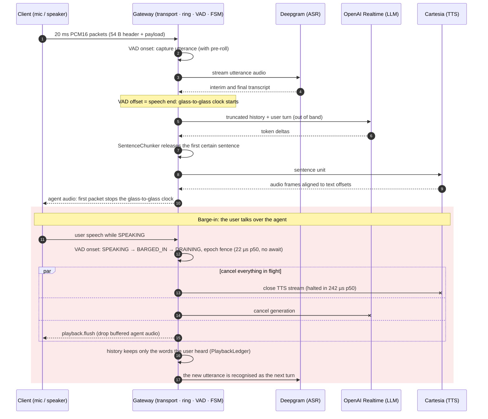

# voice-ai-realtime-gateway

[](pyproject.toml)
[](pyproject.toml)
[](pyproject.toml)
[](scripts/coverage-gate.sh)
[](pyproject.toml)
[](https://github.com/mikeZ98/voice-ai-realtime-gateway/commits/main)
[](docs/PRODUCTION.md#6-mutation-testing)

A full-duplex voice agent gateway for Python 3.12+ and asyncio: audio in, speech
recognition, LLM, speech synthesis, audio out, over one WebSocket per call. It handles
barge-in in microseconds, keeps memory bounded per call, and drains gracefully across
rollouts. The package has **zero runtime dependencies**. The ASGI server is a
deployment choice, pinned only in the container image.

## Architecture


Around every call: admission before the upgrade, a per-call watchdog, the zombie reaper,
the two-phase drain and Prometheus metrics. Each process runs one event loop.


| Layer | Package | Responsibility |
|---|---|---|
| Domain | `domain/` | 8-state session FSM with a synchronous barge-in critical section, Lamport ordering, task supervision |
| Core | `core/` | bounded zero-copy `AudioRingBuffer` (backpressure or drop-oldest, epoch fencing), token buckets |
| Transport | `transport/` | binary audio packets plus typed JSON control on one WebSocket; RFC 6455 close codes; heartbeat; `MemoryWebSocket` |
| VAD | `vad/` | deterministic energy VAD with two-threshold hysteresis and hangover |
| Inference | `inference/` | `VoiceAgentPipeline`: ASR → LLM → sentence chunker → TTS behind async-generator ports; truthful history under barge-in |
| Adapters | `adapters/` | Deepgram, OpenAI Realtime and Cartesia behind those ports, sharing one retry and reconnect state machine |
| Production | `production/` | JWT admission, tenant policy, per-provider circuit breakers, zombie reaper, Prometheus metrics, status app |
| Deploy | `deploy/` | ASGI front end, two-phase graceful drain, preStop hook, settings, demo app |

### Design principles

* **Bounded everything.** Every queue, ring, buffer and window has a frame and byte
  bound chosen up front. Overload drops or backpressures, never grows: memory per call
  is a constant, not a function of how slow a peer is.
* **No `await` on the critical path.** Barge-in moves `SPEAKING → BARGED_IN → DRAINING`,
  fences the audio epoch and cancels generation synchronously. Stale audio cannot leak
  past the fence, whatever the scheduler does next.
* **Truth over optimism.** The conversation history keeps only the whole words the user
  can have heard, derived from the playback ledger rather than from what was
  generated.
* **One loop, no locks.** Each process confines its state to one event loop. Scale-out is
  by process or pod, sized by measured loop capacity.
* **Fail closed, recover gradually.** Admission runs before the upgrade. A failing
  provider opens its circuit and new calls get `1013`; recovery is probed with
  exponential backoff.
* **Proof, not claims.** 100 % line and branch coverage, `mypy --strict`, Hypothesis
  stateful fuzzing, AST mutation testing, and a network-free load benchmark that writes
  a JSON report.

## A turn, and a barge-in



## Quantitative proofs

| Property | Result | Evidence |
|---|---|---|
| 1,000 concurrent full-duplex calls (4 loops × 250) | 1,000 / 1,000 completed, 4,000 / 4,000 turns answered, 0 failed | `benchmarks/bench_concurrency.py` |
| Event-loop lag at 1,000 calls (budget p99 < 5 ms) | **p99 0.93 ms** (p50 0.18, max 13.7 ms) | benchmark report |
| Glass-to-glass at 1,000 calls (VAD offset → first agent packet, incl. 20 ms TTS frame) | **p50 21.1 ms, p99 25.6 ms** (gateway share ≈ 1 ms) | benchmark report |
| Agent-audio frame jitter at 1,000 calls | p50 0.06 ms, **p99 2.5 ms** | benchmark report |
| Single-loop capacity, 20 ms framing | within budget at 500 calls (lag p99 2.6 ms); saturated at 750 | benchmark sweep |
| Memory under churn (1,000 calls served after warm-up) | **14.8 B/call** fitted growth (leak budget 256 B), registry empty | benchmark report |
| Barge-in to `DRAINING` (budget 15 ms) | **p50 22 µs, p99 27 µs**, max 97 µs | [`ARCHITECTURE.md`](docs/ARCHITECTURE.md) |
| TTS halted after barge-in onset (budget 5 ms) | **p50 242 µs, p99 434 µs** | [`INFERENCE.md`](docs/INFERENCE.md) |
| Ingress cost per 20 ms frame (decode, checks, ring, VAD) | ≈ 10 µs, 0.05 % of a core per call | [`TRANSPORT.md`](docs/TRANSPORT.md) |
| Mutation score: barge-in, chunker, ring | **98.56 %** (206 / 209; 3 documented equivalent mutants) | `scripts/mutation-test.py` |
| Coverage | **100.00 %** line + branch, every file | `scripts/coverage-gate.sh` |
| Graceful drain under uvicorn | live call kept for the full budget, new connections `1013`, `/drainz` 200, hook exit 0 | [`DEPLOYMENT.md`](docs/DEPLOYMENT.md) |

Measured on CPython 3.12.13 on an Apple M4. Methodology and caveats are in
[`docs/DEPLOYMENT.md`](docs/DEPLOYMENT.md#7-concurrency-benchmark-benchmarksbench_concurrencypy).

## Quickstart

```bash
uv sync                                                    # Python 3.12 + dev toolchain

# Serve the demo agent (in-memory ASR / LLM / TTS doubles, no provider keys needed)
export GATEWAY_KEYS="k1=$(openssl rand -base64 48 | tr '+/' '-_' | tr -d '=')"
export GATEWAY_TENANTS='{"demo": {"max_concurrent_sessions": 50, "max_session_duration_s": 600}}'
uv run --with uvicorn==0.35.0 --with websockets==15.0.1 \
  uvicorn --factory voice_ai_realtime_gateway.deploy.app:create_demo_app \
  --port 8080 --ws websockets --lifespan on

curl -s localhost:8080/readyz                               # ready
curl -s localhost:8080/metrics | grep voice_gateway_active  # Prometheus exposition
```

Clients connect to `ws://localhost:8080/v1/voice` with `Authorization: Bearer <HS256
JWT>` (browsers: `?access_token=`). The token carries `aud`, `exp`, `tenant`, `codecs`
and `max_duration_s`; `TokenSigner` mints test tokens. Audio uses the 54-byte binary
packet format and control uses typed JSON (`session.close`, `response.cancel`,
`playback.flush`, ...). See [`docs/TRANSPORT.md`](docs/TRANSPORT.md).

Container and cluster:

```bash
docker build -f deploy/Dockerfile -t voice-gateway .
kubectl create secret generic voice-gateway-keys --from-literal=GATEWAY_KEYS="$GATEWAY_KEYS"
kubectl apply -k deploy/k8s                                 # Deployment, Service, PDB, KEDA
```

Embedding the pipeline with your own providers:

```python
import os

from voice_ai_realtime_gateway.deploy import GatewaySettings, build_app
from voice_ai_realtime_gateway.inference import VoiceAgentPipeline
from voice_ai_realtime_gateway.vad import EnergyVAD


def pipeline(context):  # CallContext: transport, admission, sink, on_close
    return VoiceAgentPipeline(
        transport=context.transport,
        vad=EnergyVAD(),
        asr=my_deepgram_asr,  # DeepgramStreamingASR(connector, ...)
        llm=my_openai_llm,  # OpenAIRealtimeLLM(connector, ...)
        tts=my_cartesia_tts,  # CartesiaStreamingTTS(connector, ...)
        sink=context.sink,
    )


app = build_app(GatewaySettings.from_env(os.environ), pipeline)  # any ASGI server
```

## CLI

| Command | Purpose |
|---|---|
| `uv run python -m benchmarks.bench_concurrency [--sessions 1000] [--shards 4] [--turns 4] [--ramp 2] [--churn-waves 8] [--churn-sessions 100] [--sweep 250,500] [--output PATH]` | load benchmark; writes `.cache/benchmarks/concurrency_report.json`, exits 1 if a threshold fails |
| `python -m voice_ai_realtime_gateway.deploy.drain [--pid 1] [--signal SIGUSR1] [--url http://127.0.0.1:8080/drainz] [--timeout 45] [--interval 0.5]` | Kubernetes preStop hook: start the drain, wait for `/drainz` |
| `uv run python scripts/mutation-test.py [--target barge-in\|chunker\|ring] [--jobs N] [--min-score 95]` | AST mutation testing; report in `.cache/mutation/report.json` |
| `./scripts/coverage-gate.sh` | 100.00 % line + branch gate, per file |
| `./scripts/audit-attribution.sh` | every commit authored and committed by the sole maintainer identity |
| `./scripts/audit-hygiene.sh` | no absolute machine paths, tracked artifacts or cache leaks |

## Configuration

| Variable | Default | Meaning |
|---|---|---|
| `GATEWAY_KEYS` | *required* | `kid=base64url-secret[,kid=…]`, secrets ≥ 32 bytes (HS256) |
| `GATEWAY_TENANTS` | *required* | JSON `{"tenant": {"max_concurrent_sessions": n, "max_session_duration_s": s, "codecs": ["pcm16", …]}}` |
| `GATEWAY_AUDIENCE` | `voice-gateway` | expected token `aud` |
| `GATEWAY_WEBSOCKET_PATH` | `/v1/voice` | media route |
| `GATEWAY_DRAIN_TIMEOUT_S` | `30` | phase-1 drain budget for live calls |
| `GATEWAY_FINAL_SCRAPE_GRACE_S` | `15` | hold after the drain for a last Prometheus scrape |
| `GATEWAY_MEDIA_TIMEOUT_S` | `10` | slow-loris bound: maximum gap between client media |
| `GATEWAY_REAPER_GRACE_S` | `30` | how far past its deadline a call may run before it is quarantined |
| `GATEWAY_REQUIRED_PROVIDERS` | *(none)* | comma list of providers whose open circuit refuses new calls with `1013` |

Circuit-breaker, VAD, transport-limit and heartbeat policies are typed dataclasses
(`CircuitPolicy`, `VadConfig`, `TransportLimits`, `HeartbeatConfig`) for code-level
tuning.

## Verification

```bash
uv run ruff check . && uv run ruff format --check .   # every rule family, documented ignores
uv run mypy src tests benchmarks                      # --strict
uv run bandit -c pyproject.toml -r src
uv run pytest                                         # network-free (pytest-socket), warnings are errors
./scripts/coverage-gate.sh                            # 100.00 % line + branch
./scripts/audit-attribution.sh
./scripts/audit-hygiene.sh
uv run python scripts/mutation-test.py                # >= 95 % required, 98.56 % achieved
uv run python -m benchmarks.bench_concurrency         # 1,000-call load proof
```

Every tool cache (pytest, ruff, mypy, coverage, Hypothesis, uv, mutation, benchmarks)
lives under `./.cache/`. CPython bytecode can only be redirected through the
environment, so export `PYTHONPYCACHEPREFIX="$PWD/.cache/pycache"` in your shell; the
gate scripts default to that location themselves.

## Documentation

| Document | Contents |
|---|---|
| [`docs/ARCHITECTURE.md`](docs/ARCHITECTURE.md) | session FSM and transition matrix, barge-in critical section, ring and memory budget model |
| [`docs/TRANSPORT.md`](docs/TRANSPORT.md) | wire protocol, framing, close codes, VAD, data flow, overhead model |
| [`docs/INFERENCE.md`](docs/INFERENCE.md) | pipeline, sentence chunking, playback truncation, end-to-end tracing |
| [`docs/PRODUCTION.md`](docs/PRODUCTION.md) | provider adapters, resilience, metrics, admission, mutation testing |
| [`docs/DEPLOYMENT.md`](docs/DEPLOYMENT.md) | graceful drain, circuit breakers, reaper, image, Kubernetes, load benchmark |
