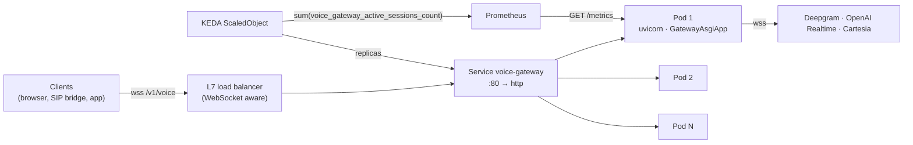

# Deployment, graceful drain, self-healing and load results

This document covers how the gateway runs in production: the process composition, the
two-phase drain that lets rollouts finish calls instead of cutting them, the
per-provider circuit breakers and zombie reaper, the container image, the Kubernetes
topology, and the concurrency benchmark that sizes it.

## 1. Topology



Each pod is one process with one event loop: uvicorn as PID 1, serving
`GatewayAsgiApp` on port 8080. The media WebSocket (`/v1/voice`) and the status routes
(`/healthz`, `/readyz`, `/drainz`, `/metrics`) share the port. `build_app(settings,
factory)` wires one process:

| Object | Role |
|---|---|
| `SessionRegistry` | live calls; source of the active-sessions and ring-bytes gauges |
| `GatewayMetrics` | Prometheus registry (`/metrics`) and telemetry sink |
| `CircuitRegistry` | per-provider breakers; telemetry sink and admission gate |
| `GatewayServer` | admission (JWT, tenant caps, codecs, circuits), per-call watchdog |
| `DrainController` | two-phase drain (section 2) |
| `ZombieReaper` | force-isolates calls past their deadline (section 4) |
| `StatusApp` | health, readiness, drain completion, metrics |

Settings come from `GATEWAY_*` environment variables (`GatewaySettings.from_env`, see the
README). Errors name the offending variable, and signing keys must be base64url and at
least 32 bytes.

## 2. Two-phase graceful drain

```text
            trigger()                    no live calls,
 SERVING ─────────────► DRAINING ─────── or drain_timeout_s ──────► FLUSHING ──► DRAINED
  /readyz 200            /readyz 503                                 flush hook    /drainz 200
                         new calls → 1013                            final-scrape
                         live calls continue                         grace
                                         leftovers → 1001 (+5 s grace)
```

* **Phase 1, DRAINING.** `GatewayServer.begin_drain()` stops admission. `/readyz`
  returns 503, so endpoints and external load balancers stop routing. Connections that
  still arrive are **accepted and then closed with `1013` (try again later)**, so the
  client gets a retry signal, not a failed handshake. Live calls continue for up to
  `drain_timeout_s` (default 30 s).
* **Phase 2, FLUSHING.** Calls still alive at the deadline are closed with `1001` (going
  away), with a 5 s grace for their teardown. The optional `flush` hook runs, then the
  controller holds for `final_scrape_grace_s` (default 15 s), so Prometheus scrapes the
  final counters. `/drainz` turns 200.

The drain is idempotent: a signal, the preStop hook and lifespan shutdown can all
trigger it, and there is only ever one drain task. A waiter that is cancelled does not
cancel the drain itself (`asyncio.shield`).

**Why the trigger is `SIGUSR1`, not `SIGTERM`.** On `SIGTERM`, uvicorn closes every open
WebSocket with `1012` before the application hears about it, which would cut live calls
mid-sentence. The pod's `preStop` hook therefore runs:

```bash
python -m voice_ai_realtime_gateway.deploy.drain --pid 1 --url http://127.0.0.1:8080/drainz --timeout 55
```

That command sends `SIGUSR1` (the lifespan startup handler starts the drain), polls
`/drainz` until it returns 200, and exits 0, or 1 on timeout. Kubernetes only sends
`SIGTERM` after the hook returns, by which time there is nothing left to cut. The probe
only accepts plain-HTTP loopback URLs. When the gateway owns its event loop, the same
controller can be bound to `SIGTERM` (`DrainController.install(loop, (signal.SIGTERM,))`).

**Close codes at the edge.**

| Situation | Handshake | Close |
|---|---|---|
| Bad or expired token, unknown tenant, codec not allowed, session binding mismatch | refused before accept (HTTP 403) | `1008` |
| Draining, tenant at capacity, required provider circuit open | accepted, then closed | `1013` |
| Live call still running at the drain deadline | | `1001` |
| Hangup by the client | | `1000` |

**Budget arithmetic.** These are pinned by `tests/deploy/test_manifests.py`: a change
to one number that breaks the nesting fails CI.

| Budget | Value | Constraint |
|---|---|---|
| `GATEWAY_DRAIN_TIMEOUT_S` | 30 s | live calls finish naturally |
| forced-close grace | 5 s | `_SHUTDOWN_GRACE_S` |
| `GATEWAY_FINAL_SCRAPE_GRACE_S` | 15 s | at least one Prometheus scrape interval |
| preStop `--timeout` | 55 s | ≥ 30 + 5 + 15 |
| uvicorn `--timeout-graceful-shutdown` | 10 s | after `SIGTERM` |
| `terminationGracePeriodSeconds` | 75 s | > 55 + 10, so no `SIGKILL` mid-drain |

**Verified live**, with the image's exact install recipe under uvicorn 0.35 and
websockets 15: a forged token got HTTP 403; a full call got agent audio and closed with
`1000` on hangup. During the drain, `/readyz` and `/drainz` returned 503 and a new
connection got `1013`. The call left open was closed with `1001` after the 3 s
budget, `/drainz` turned 200, the hook exited 0, and `SIGTERM` then shut uvicorn
down cleanly.

## 3. Per-provider circuit breakers

```text
CLOSED ──(≥ min_calls and failure ratio ≥ threshold in the rolling window)──► OPEN
OPEN ──(cooldown elapsed)──► HALF_OPEN
HALF_OPEN ──(`probes` consecutive successes)──► CLOSED   (window and backoff reset)
HALF_OPEN ──(any failure)──► OPEN                         (cooldown grows)
```

| `CircuitPolicy` | Default | Meaning |
|---|---|---|
| `window_s` / `buckets` | 30 s / 10 | rolling error window in time buckets: O(1) record, O(buckets) memory |
| `min_calls` | 20 | no verdict on a handful of calls |
| `failure_ratio` | 0.5 | open at ≥ 50 % failures in the window |
| `open_s`, `backoff`, `max_open_s` | 5 s, ×2, 120 s | n-th consecutive opening waits `min(120, 5·2ⁿ⁻¹)` s: 5, 10, 20, 40, 80, 120 |
| `probes` | 3 | probe calls let through per `open_s` while half-open; slots expire, so a probe that never reports cannot wedge the breaker |

Signals come from the provider resilience layer through telemetry: `ProviderConnected`
counts as a success and `ProviderError` as a failure. `CircuitRegistry.blocking()` runs
in admission. It claims probe slots only when *every* required provider is available,
so a half-open STT probe is not spent on a call that the open LLM breaker would refuse
anyway. Such calls are refused with `1013 upstream unavailable`, before any pipeline,
ring or upstream connection is built. `select(*candidates)` lets a pipeline factory fall
back to the first healthy alternative provider. State and rejections are exported as
`voice_gateway_circuit_state{provider}` (0 closed, 1 half-open, 2 open) and
`voice_gateway_circuit_rejections_total{provider}`.

## 4. Zombie session reaper

Every call already has a watchdog (maximum duration, slow-loris media timeout). The
reaper is the backstop for a call whose own task is wedged: a pipeline stuck in a
non-cancellable await, or teardown that never completes. Every `interval_s` (5 s) it
sweeps the registry for calls past `deadline + grace_s` (30 s). For each one it emits
`SessionReaped`, then calls `quarantine()`: close the socket with `1011`, abort the
session, cancel the call task, and release its registry slot and tenant count
idempotently. Siblings are untouched. Reaps are counted in
`voice_gateway_sessions_reaped_total`.

## 5. Container image (`deploy/Dockerfile`)

* **Build stage.** Pinned `ghcr.io/astral-sh/uv:0.11.7` builds the wheel. A venv
  receives the hash-locked ASGI server (`deploy/requirements-runtime.txt`, installed
  with `--require-hashes`) and the gateway wheel (`--no-deps`: it has zero
  dependencies).
* **Deterministic bytecode.** `compileall --invalidation-mode checked-hash` stores a
  source hash instead of an mtime. This was verified: deleting all `.pyc` files,
  touching every source file and recompiling produces byte-identical bytecode.
* **Runtime stage.** Only the venv is copied, owned by root and read-only to the process.
  There is no uv, pip cache or build context. The process runs as uid/gid 10001 with
  `PYTHONDONTWRITEBYTECODE=1`, so it works on a read-only root filesystem.
* `.dockerignore` whitelists the five build inputs; everything else stays out of the
  context.

```bash
docker build -f deploy/Dockerfile -t voice-gateway .
docker run --rm -p 8080:8080 \
  -e GATEWAY_KEYS="k1=$(openssl rand -base64 48 | tr '+/' '-_' | tr -d '=')" \
  -e GATEWAY_TENANTS='{"demo": {"max_concurrent_sessions": 50, "max_session_duration_s": 600}}' \
  voice-gateway
```

The default `CMD` serves `create_demo_app`, with the deterministic in-memory ASR, LLM
and TTS doubles, so a freshly built image can be smoke-tested without provider
credentials. Production images keep the same entry point with their own factory
(`build_app(settings, my_factory)`).

## 6. Kubernetes (`deploy/k8s/`, `kubectl apply -k deploy/k8s`)

| Manifest | Key settings |
|---|---|
| `deployment.yaml` | 3 replicas; `maxUnavailable: 0`, `maxSurge: 25%`. Non-root 10001, `readOnlyRootFilesystem`, all capabilities dropped, `RuntimeDefault` seccomp, no service-account token. Zone and host spread. Startup, liveness (`/healthz`) and readiness (`/readyz`) probes. preStop drain. `terminationGracePeriodSeconds: 75` |
| `service.yaml` | ClusterIP 80 → `http`, `appProtocol: kubernetes.io/ws` |
| `pdb.yaml` | `maxUnavailable: 1`: node drains evict one pod at a time, and each still drains |
| `configmap.yaml` | `GATEWAY_*` settings. Keys come from the `voice-gateway-keys` Secret, which is never committed |
| `keda-scaledobject.yaml` | scales on `sum(voice_gateway_active_sessions_count)` at 150 calls per pod, 3 to 60 replicas. Scale-up doubles every 30 s; scale-in removes one pod per 2 min after a 10 min window, so calls end on their own |
| `hpa.yaml` | the same policy via prometheus-adapter. The kustomization lists exactly one autoscaler, and a test enforces that |

**Why scale on sessions, not CPU.** A voice pod's binding constraint is event-loop
latency, and that degrades sharply at a concurrency knee (section 7) while average CPU
still looks moderate. The 150-call target sits below the per-pod tenant cap (200) and
well below the measured single-loop knee (500 to 750 calls with 20 ms framing). New
replicas therefore come up before any pod starts refusing calls or adding jitter.

## 7. Concurrency benchmark (`benchmarks/bench_concurrency.py`)

**What runs.** Every simulated call goes through the production `GatewayServer`: JWT
admission, registry, metrics, the WebSocket transport (framing, sequencing, heartbeat,
rate limits), the energy VAD, ingress rings, speech capture, ASR → LLM → sentence
chunker → TTS, and the playback ledger. Only the network and the providers are
simulated. Each call is a `MemoryWebSocket` pair, and the models are the deterministic
doubles. The TTS emits audio **in real time** (one 20 ms frame per 20 ms), as streaming
synthesizers do. Each client streams microphone audio at the real 20 ms cadence on an
absolute schedule: 300 ms of speech, then silence while the agent answers, for 4 turns,
then a hangup. Starts are spread over 2 s and every call lasts longer than that, so all
calls overlap. Overlap is checked from timestamps, not assumed.

**Sharding.** One gateway process runs one event loop, so 1,000 calls are spread over 4
loops (spawned processes started at a common monotonic instant), as 4 pods or uvicorn
workers would be. The single-loop sweep below shows why one loop per 1,000 calls is not
a sound deployment.

**Metrics.**
* *Glass-to-glass*: VAD offset to the first agent packet leaving the gateway, the
  `voice_gateway_glass_to_glass_seconds` definition. It includes the TTS's first 20 ms
  frame.
* *Client turn latency*: last spoken frame sent to first agent audio received. It
  includes the 300 ms VAD hangover, which is endpointing, not processing.
* *Frame jitter*: deviation of agent-audio inter-arrival times from 20 ms.
* *Event-loop lag*: overshoot of a 1 ms sleep probe.
* *Churn memory*: live `tracemalloc` bytes attributed to the gateway after each wave of
  complete calls, post-GC, with the harness's own sample arrays excluded. Growth is
  fitted per call served.

**Results.** CPython 3.12.13 on an Apple M4 (4 performance cores):

| 1,000 concurrent calls, 4 loops × 250 | p50 | p95 | p99 | max |
|---|---|---|---|---|
| Glass-to-glass (incl. 20 ms TTS first frame) | 21.06 ms | 22.23 ms | 25.64 ms | 39.19 ms |
| Client turn latency (incl. 300 ms hangover) | 321.2 ms | 322.5 ms | 328.5 ms | 339.2 ms |
| Agent-audio frame jitter | 0.06 ms | 0.43 ms | 2.51 ms | 14.88 ms |
| Event-loop lag (budget: p99 < 5 ms) | 0.18 ms | 0.45 ms | **0.93 ms** | 13.71 ms |

1,000 of 1,000 calls completed, all 4,000 turns were answered, and no call failed.
184,001 frames came in and 40,000 went out (39.4k frames/s), and every registry was
empty at the end. Peak RSS was 58 MiB per loop. The gateway's own share of
glass-to-glass is about 1 ms at the median: the measurement minus the 20 ms synthesis
frame.

**Single-loop capacity sweep** (one fresh process per point, same call script):

| Calls on one loop | Loop lag p99 / max | Glass-to-glass p99 | Jitter p99 | Peak RSS | Lag budget |
|---|---|---|---|---|---|
| 250 | 1.22 / 12.9 ms | 23.1 ms | 0.91 ms | 58 MiB | ✅ |
| 500 | 2.61 / 17.6 ms | 36.8 ms | 4.81 ms | 86 MiB | ✅ |
| 750 | 65.9 / 110.5 ms | 693 ms | 106 ms | 122 MiB | ❌ saturated |
| 1,000 | 90.2 / 173.3 ms | 944 ms | 119 ms | 151 MiB | ❌ saturated |

The knee is between 500 and 750 calls per loop. Past it, 20 ms framing offers more
messages than one CPython core can process (about 25 µs per frame end to end), and
latency grows with the backlog. The marginal cost is about 110 KiB RSS per live call.

**Churn.** After 2 warm-up waves, 8 waves × 100 complete calls left live gateway memory
at about 204 to 216 KB. The spread was 11.8 KB, the fitted growth 14.8 B per call
served (budget 256 B), and the registry ended empty. A 16-wave run plateaued at about
215 KB ± 4 KB after 1,700 calls. The small residual slope is allocator freelists and
caches settling. A leaked session (pipeline, rings, transport) would cost tens of KB
per call, about 100× the budget.

**Caveats.** The simulated clients share each loop with the gateway, so the measured
capacity is conservative on that axis. `MemoryWebSocket` leaves out kernel, TLS and
WebSocket framing costs, which are real in production and push the other way. Size
pods from the knee with headroom, as the 150-call KEDA target does. The max lag
(13.7 ms) comes from CPython's generation-2 garbage collections, which traverse the
live call heap: about 15 ms at 500 calls per loop. `gc.freeze()` does not help,
because the startup heap is only 25k objects. The p99 stays below 1 ms.

Two hot paths were fixed while profiling this benchmark:
* `AudioRingBuffer._wait` no longer calls `deque.remove()` on already-woken waiters.
  On CPython 3.12+ the failing call formats `repr(future)` into its error message, at
  about 4 µs per frame hand-off.
* The ASR double's peak scan moved from a per-sample generator to C-level `max`/`min`.

```bash
uv run python -m benchmarks.bench_concurrency --sweep 250,500,750,1000
```

The command writes `.cache/benchmarks/concurrency_report.json` and exits 1 if any
threshold fails.

## 8. Verified by

| Property | Test |
|---|---|
| Drain phases, deadline, forced close, leftovers, idempotency, cancelled waiter, signals | `tests/deploy/test_lifecycle.py` |
| Pre-accept 403 vs accept-then-1013, full call over ASGI, real `SIGUSR1` drain, lifespan, adapter contract | `tests/deploy/test_asgi.py` |
| preStop hook: signal, polling, timeout, loopback-only probe | `tests/deploy/test_drain_cli.py` |
| Settings parsing and every invalid variable | `tests/deploy/test_app.py` |
| Manifests ↔ code: ports, probe routes, hook arguments, budget nesting, metric names, uid, image pinning, lock hashes | `tests/deploy/test_manifests.py` |
| Breaker thresholds, window ageing, probes, exponential cooldown, registry gating | `tests/production/test_circuit.py` |
| Circuit admission, `close_all`, reaper isolation | `tests/production/test_server.py` |
| Benchmark harness: single loop, sharded CLI, sweep, report schema | `tests/benchmarks/test_bench_concurrency.py` |
